# Структура базы данных GO&GET

Документация соответствует [миграциям](../../migrations/).

В схеме используются следующие таблицы:

- user_account — пользователи платформы, их город, текст «о себе», файл аватарки и подтверждены ли почта и телефон, новая почта, которая ждёт подтверждения.
- city — справочник городов для профиля.
- category — категории объявлений.
- ad — объявления, их авторы, категории, цены (в копейках), статусы (draft, moderation, rejected, active, closed, sold), тип (goods — товар, service — услуга), город и доставка.
- cart — корзины пользователей, не более одной на пользователя.
- cart_item — объявления в корзине.
- favorites — избранные объявления.
- ad_status_event — история статусов объявлений.
- price_history — история цен объявлений.
- conversation — диалоги покупателей и продавцов.
- message — сообщения в диалогах и их статусы.
- views — просмотры объявлений.
- review — отзывы и рейтинги от 1 до 5. Хранит продавца и название объявления, поэтому переживает удаление объявления.
- promotion — периоды и уровни платного продвижения объявлений.
- ad_reaction — реакции пользователей.
- session — сессии пользователей с идентификатором и временем истечения.
- password_reset — ссылки для сброса пароля: хеш токена, срок действия и время использования.
- email_verification — ссылки для подтверждения почты: хеш токена, email, на который ушла ссылка, срок действия и время использования.
- ad_image — фотографии объявлений.
- review_image — фотографии к отзывам.
- address — адреса доставки пользователя; у пользователя не больше одного основного адреса.
- seller_report — жалобы на продавцов: кто пожаловался, причина и комментарий.

Триггеры обновляют updated_at пользователей, объявлений и отзывов, сохраняют начальные значения и изменения цены и статуса, заполняют продавца нового диалога, продавца и название объявления у нового отзыва и проверяют отправителя сообщения. В истории статусов actor_id заполняется идентификатором владельца объявления. Корзины и сессии автоматически триггерами не создаются.

## ER-диаграмма

```mermaid
erDiagram
    direction TB

    user_account {
        integer user_id PK
        varchar(100) first_name
        varchar(255) email UK
        varchar(20) phone_number UK
        date birthday
        varchar(255) password_hash
        timestamptz created_at
        timestamptz updated_at
        varchar(20) type
        integer city_id FK
        varchar(500) about
        varchar(100) avatar
        boolean email_verified
        varchar(255) pending_email
        boolean phone_verified
    }

    city {
        integer city_id PK
        varchar(100) name UK
    }

    category {
        integer category_id PK
        integer parent_id FK
        varchar(100) name
        varchar(120) slug UK
    }

    ad {
        integer id PK
        varchar(200) title
        text description
        bigint price
        int user_id FK
        timestamptz created_at
        timestamptz updated_at
        varchar(20) status
        int category_id FK
        varchar(20) type_ad
        varchar(100) city
        boolean has_delivery
    }

    cart {
        integer id PK
        int user_id FK, UK
        timestamptz created_at
    }

    cart_item {
        integer id PK
        int cart_id FK
        int ad_id FK
    }

    favorites {
        integer id PK
        int user_id FK
        int ad_id FK
    }

    ad_status_event {
        integer stat_id PK
        int ad_id FK
        int actor_id FK
        varchar(20) status
        timestamptz changed_at
    }

    price_history {
        integer prh_id PK
        int ad_id FK
        bigint price
        timestamptz changed_at
    }

    conversation {
        integer room_id PK
        int ad_id FK
        int buyer_id FK
        int seller_id FK
        timestamptz created_at
    }

    message {
        integer message_id PK
        int sender_id FK
        int room_id FK
        text text
        timestamptz sent_at
        varchar(20) status
    }

    views {
        integer views_id PK
        int user_id FK
        int ad_id FK
        timestamptz view_at
    }

    review {
        integer rew_id PK
        int user_id FK
        int ad_id FK
        text text
        numeric rating
        timestamptz created_at
        timestamptz updated_at
        int seller_id FK
        varchar(200) listing_title
    }

    promotion {
        integer prom_id PK
        int ad_id FK
        timestamptz when_paid
        timestamptz end_date
        int promotion_level
    }

    ad_reaction {
        integer like_id PK
        int user_id FK
        int ad_id FK
        boolean is_like
    }

    session {
        text id PK
        integer user_id FK
        timestamptz expires_at
    }

    password_reset {
        char(64) token_hash PK
        integer user_id FK
        timestamptz created_at
        timestamptz expires_at
        timestamptz used_at
    }

    email_verification {
        char(64) token_hash PK
        integer user_id FK
        varchar(255) email
        timestamptz created_at
        timestamptz expires_at
        timestamptz used_at
    }

    ad_image {
        integer image_id PK
        integer ad_id FK
        text url
        integer position
        text alt_text
        timestamptz created_at
    }

    review_image {
        integer image_id PK
        integer rew_id FK
        text url
        integer position
        timestamptz created_at
    }

    address {
        integer address_id PK
        integer user_id FK
        varchar(200) street
        varchar(50) house
        varchar(200) comment
        boolean is_default
        timestamptz created_at
    }

    seller_report {
        integer report_id PK
        integer seller_id FK
        integer reporter_id FK
        varchar(20) reason
        varchar(500) comment
        timestamptz created_at
    }

    category |o..o{ category : parent_id
    city |o..o{ user_account : city_id
    user_account ||..o{ ad : user_id
    category |o..o{ ad : category_id
    user_account ||..o| cart : user_id
    cart ||..o{ cart_item : cart_id
    ad ||..o{ cart_item : ad_id
    user_account ||..o{ favorites : user_id
    ad ||..o{ favorites : ad_id
    ad ||..o{ ad_status_event : ad_id
    user_account |o..o{ ad_status_event : actor_id
    ad ||..o{ price_history : ad_id
    ad |o..o{ conversation : ad_id
    user_account ||..o{ conversation : buyer_id
    user_account |o..o{ conversation : seller_id
    user_account ||..o{ message : sender_id
    conversation ||..o{ message : room_id
    user_account |o..o{ views : user_id
    ad ||..o{ views : ad_id
    user_account ||..o{ review : user_id
    ad |o..o{ review : ad_id
    user_account ||..o{ review : seller_id
    ad ||..o{ promotion : ad_id
    user_account ||..o{ ad_reaction : user_id
    ad ||..o{ ad_reaction : ad_id
    user_account ||..o{ session : user_id
    user_account ||..o{ password_reset : user_id
    user_account ||..o{ email_verification : user_id
    ad ||..o{ ad_image : ad_id
    review ||..o{ review_image : rew_id
    user_account ||..o{ address : user_id
    user_account ||..o{ seller_report : seller_id
    user_account ||..o{ seller_report : reporter_id
```

