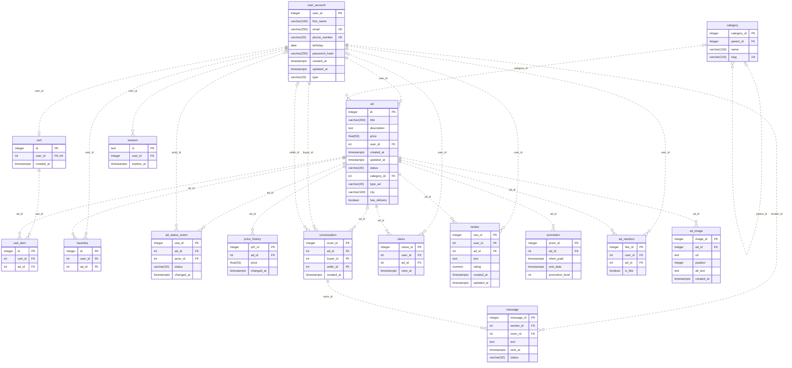

# Структура базы данных GO&GET

Документация соответствует [текущей миграции](../../migrations/1_init.sql).

В схеме используются следующие таблицы:

- user_account — пользователи платформы. Имя обязательно, но не уникально; email и телефон уникальны. Никнейма нет.
- category — категории объявлений; parent_id указывает на родительскую категорию.
- ad — объявления, их авторы, категории, цены, статусы, город и доставка.
- cart — корзины пользователей, не более одной на пользователя.
- cart_item — объявления в корзине; пара cart_id/ad_id уникальна.
- favorites — избранные объявления; пара user_id/ad_id уникальна.
- ad_status_event — история статусов объявлений.
- price_history — история цен объявлений.
- conversation — диалоги покупателей и продавцов.
- message — сообщения в диалогах и их статусы.
- views — просмотры объявлений.
- review — отзывы и рейтинги; пара user_id/ad_id уникальна.
- promotion — периоды и уровни платного продвижения объявлений.
- ad_reaction — реакции пользователей; пара user_id/ad_id уникальна.
- session — сессии пользователей с идентификатором и временем истечения.
- ad_image — фотографии объявлений; позиция уникальна в пределах объявления.

Цены имеют тип FLOAT(53), рейтинг — NUMERIC(3,2), временные отметки — timestamptz. В схеме есть PRIMARY KEY, FOREIGN KEY, UNIQUE и NOT NULL; ограничений CHECK нет.

Триггеры обновляют updated_at пользователей, объявлений и отзывов, сохраняют начальные значения и изменения цены и статуса, заполняют продавца нового диалога и проверяют отправителя сообщения. В истории статусов actor_id заполняется идентификатором владельца объявления. Корзины и сессии автоматически триггерами не создаются.

## ER-диаграмма



Составные UNIQUE описаны в SQL ниже; обозначение UK у поля показывает только индивидуальную уникальность.

Ниже приведён полный SQL миграции Goose. Раздел Up создаёт объекты, раздел Down удаляет их вместе с данными.

```sql
-- +goose Up
CREATE TABLE user_account (
    user_id        integer GENERATED ALWAYS AS IDENTITY PRIMARY KEY,
    first_name     varchar(100) NOT NULL,
    email          varchar(255) NOT NULL UNIQUE,
    phone_number   varchar(20) NOT NULL UNIQUE,
    birthday       date,
    password_hash  varchar(255) NOT NULL,
    created_at     timestamptz NOT NULL DEFAULT now(),
    updated_at     timestamptz NOT NULL DEFAULT now(),
    type           varchar(20) NOT NULL DEFAULT 'client'
);

CREATE TABLE category (
    category_id integer GENERATED ALWAYS AS IDENTITY PRIMARY KEY,
    parent_id integer REFERENCES category(category_id) ON DELETE SET NULL,
    name varchar(100) NOT NULL,
    slug varchar(120) NOT NULL UNIQUE
);

CREATE TABLE ad (
    id              integer GENERATED ALWAYS AS IDENTITY PRIMARY KEY,
    title           VARCHAR(200) NOT NULL,
    description     TEXT,
    price           FLOAT(53) NOT NULL,
    user_id         INT NOT NULL REFERENCES user_account(user_id) ON DELETE CASCADE,
    created_at      TIMESTAMPTZ NOT NULL DEFAULT now(),
    updated_at      TIMESTAMPTZ NOT NULL DEFAULT now(),
    status          VARCHAR(20) NOT NULL,
    category_id     INT REFERENCES category(category_id) ON DELETE SET NULL,
    type_ad         VARCHAR(20) NOT NULL,
    city            VARCHAR(100),
    has_delivery    BOOLEAN NOT NULL DEFAULT false
);

CREATE TABLE cart (
    id              integer GENERATED ALWAYS AS IDENTITY PRIMARY KEY,
    user_id         INT NOT NULL UNIQUE REFERENCES user_account(user_id) ON DELETE CASCADE,
    created_at      TIMESTAMPTZ NOT NULL DEFAULT now()
);

CREATE TABLE cart_item (
    id              integer GENERATED ALWAYS AS IDENTITY PRIMARY KEY,
    cart_id         INT NOT NULL REFERENCES cart(id) ON DELETE CASCADE,
    ad_id           INT NOT NULL REFERENCES ad(id)   ON DELETE CASCADE,
    UNIQUE (cart_id, ad_id)
);

CREATE TABLE favorites (
    id              integer GENERATED ALWAYS AS IDENTITY PRIMARY KEY,
    user_id         INT NOT NULL REFERENCES user_account(user_id) ON DELETE CASCADE,
    ad_id           INT NOT NULL REFERENCES ad(id)                ON DELETE CASCADE,
    UNIQUE (user_id, ad_id)
);

CREATE TABLE ad_status_event (
    stat_id         integer GENERATED ALWAYS AS IDENTITY PRIMARY KEY,
    ad_id           INT NOT NULL REFERENCES ad(id)                ON DELETE CASCADE,
    actor_id        INT          REFERENCES user_account(user_id) ON DELETE SET NULL,
    status          VARCHAR(20) NOT NULL,
    changed_at     TIMESTAMPTZ NOT NULL DEFAULT now()
);

CREATE TABLE price_history (
    prh_id          integer GENERATED ALWAYS AS IDENTITY PRIMARY KEY,
    ad_id           INT NOT NULL REFERENCES ad(id) ON DELETE CASCADE,
    price           FLOAT(53) NOT NULL,
    changed_at      TIMESTAMPTZ NOT NULL DEFAULT now()
);

CREATE TABLE conversation (
    room_id         integer GENERATED ALWAYS AS IDENTITY PRIMARY KEY,
    ad_id           INT REFERENCES ad(id) ON DELETE SET NULL,
    buyer_id        INT NOT NULL REFERENCES user_account(user_id) ON DELETE CASCADE,
    seller_id       INT          REFERENCES user_account(user_id) ON DELETE SET NULL,
    created_at      TIMESTAMPTZ NOT NULL DEFAULT now()
);

CREATE TABLE message (
    message_id      integer GENERATED ALWAYS AS IDENTITY PRIMARY KEY,
    sender_id       INT NOT NULL REFERENCES user_account(user_id) ON DELETE CASCADE,
    room_id         INT NOT NULL REFERENCES conversation(room_id) ON DELETE CASCADE,
    text            TEXT NOT NULL,
    sent_at         TIMESTAMPTZ NOT NULL DEFAULT now(),
    status          VARCHAR(20) NOT NULL DEFAULT 'sent'
);

CREATE TABLE views (
    views_id        integer GENERATED ALWAYS AS IDENTITY PRIMARY KEY,
    user_id         INT REFERENCES user_account(user_id) ON DELETE SET NULL,
    ad_id           INT NOT NULL REFERENCES ad(id)       ON DELETE CASCADE,
    view_at         TIMESTAMPTZ NOT NULL DEFAULT now()
);

CREATE TABLE review (
    rew_id          integer GENERATED ALWAYS AS IDENTITY PRIMARY KEY,
    user_id         INT NOT NULL REFERENCES user_account(user_id) ON DELETE CASCADE,
    ad_id           INT NOT NULL REFERENCES ad(id)                ON DELETE CASCADE,
    text            TEXT,
    rating          NUMERIC(3,2) NOT NULL,
    created_at      TIMESTAMPTZ NOT NULL DEFAULT now(),
    updated_at      TIMESTAMPTZ NOT NULL DEFAULT now(),
    UNIQUE (user_id, ad_id)
);

CREATE TABLE promotion (
    prom_id         integer GENERATED ALWAYS AS IDENTITY PRIMARY KEY,
    ad_id           INT NOT NULL REFERENCES ad(id) ON DELETE CASCADE,
    when_paid       TIMESTAMPTZ NOT NULL DEFAULT now(),
    end_date        TIMESTAMPTZ NOT NULL,
    promotion_level INT NOT NULL
);

CREATE TABLE ad_reaction (
    like_id         integer GENERATED ALWAYS AS IDENTITY PRIMARY KEY,
    user_id         INT NOT NULL REFERENCES user_account(user_id) ON DELETE CASCADE,
    ad_id           INT NOT NULL REFERENCES ad(id)                ON DELETE CASCADE,
    is_like         BOOLEAN NOT NULL DEFAULT false,
    UNIQUE (user_id, ad_id)
);

CREATE OR REPLACE FUNCTION set_updated_at()
RETURNS TRIGGER AS $$
BEGIN
    NEW.updated_at := now();
    RETURN NEW;
END;
$$ LANGUAGE plpgsql;

CREATE TRIGGER trg_user_account_updated_at
BEFORE UPDATE ON user_account
FOR EACH ROW EXECUTE FUNCTION set_updated_at();

CREATE TRIGGER trg_ad_updated_at
BEFORE UPDATE ON ad
FOR EACH ROW EXECUTE FUNCTION set_updated_at();

CREATE TRIGGER trg_review_updated_at
BEFORE UPDATE ON review
FOR EACH ROW EXECUTE FUNCTION set_updated_at();

CREATE OR REPLACE FUNCTION log_price_change()
RETURNS TRIGGER AS $$
BEGIN
    IF TG_OP = 'INSERT' THEN
        INSERT INTO price_history (ad_id, price, changed_at)
        VALUES (NEW.id, NEW.price, now());
        RETURN NEW;
    END IF;

    IF TG_OP = 'UPDATE' AND NEW.price IS DISTINCT FROM OLD.price THEN
        INSERT INTO price_history (ad_id, price, changed_at)
        VALUES (NEW.id, NEW.price, now());
    END IF;

    RETURN NEW;
END;
$$ LANGUAGE plpgsql;

CREATE TRIGGER trg_ad_price_history
AFTER INSERT OR UPDATE OF price ON ad
FOR EACH ROW EXECUTE FUNCTION log_price_change();

CREATE OR REPLACE FUNCTION set_conversation_seller()
RETURNS TRIGGER AS $$
BEGIN
    IF NEW.seller_id IS NULL AND NEW.ad_id IS NOT NULL THEN
        SELECT user_id INTO NEW.seller_id FROM ad WHERE id = NEW.ad_id;
    END IF;
    RETURN NEW;
END;
$$ LANGUAGE plpgsql;

CREATE TRIGGER trg_conversation_set_seller
BEFORE INSERT ON conversation
FOR EACH ROW EXECUTE FUNCTION set_conversation_seller();

CREATE OR REPLACE FUNCTION check_message_sender()
RETURNS TRIGGER AS $$
DECLARE
    v_buyer_id  INT;
    v_seller_id INT;
BEGIN
    SELECT buyer_id, seller_id
      INTO v_buyer_id, v_seller_id
      FROM conversation
     WHERE room_id = NEW.room_id;

    IF v_buyer_id IS NULL THEN
        RAISE EXCEPTION 'Комната % не найдена', NEW.room_id;
    END IF;

    IF NEW.sender_id <> v_buyer_id
       AND (v_seller_id IS NULL OR NEW.sender_id <> v_seller_id) THEN
        RAISE EXCEPTION
            'Пользователь % не является участником комнаты %',
            NEW.sender_id, NEW.room_id;
    END IF;

    RETURN NEW;
END;
$$ LANGUAGE plpgsql;

CREATE TRIGGER trg_message_sender_check
BEFORE INSERT OR UPDATE OF sender_id, room_id ON message
FOR EACH ROW EXECUTE FUNCTION check_message_sender();

CREATE OR REPLACE FUNCTION log_ad_status_change()
RETURNS TRIGGER AS $$
BEGIN
    IF TG_OP = 'INSERT' THEN
        INSERT INTO ad_status_event (ad_id, actor_id, status, changed_at)
        VALUES (NEW.id, NEW.user_id, NEW.status, now());
        RETURN NEW;
    END IF;

    IF TG_OP = 'UPDATE' AND NEW.status IS DISTINCT FROM OLD.status THEN
        INSERT INTO ad_status_event (ad_id, actor_id, status, changed_at)
        VALUES (NEW.id, NEW.user_id, NEW.status, now());
    END IF;

    RETURN NEW;
END;
$$ LANGUAGE plpgsql;

CREATE TRIGGER trg_ad_status_event
AFTER INSERT OR UPDATE OF status ON ad
FOR EACH ROW EXECUTE FUNCTION log_ad_status_change();

CREATE TABLE session (
    id text PRIMARY KEY,
    user_id integer NOT NULL REFERENCES user_account(user_id) ON DELETE CASCADE,
    expires_at timestamptz NOT NULL
);

CREATE TABLE ad_image (
    image_id integer GENERATED ALWAYS AS IDENTITY PRIMARY KEY,
    ad_id integer NOT NULL REFERENCES ad(id) ON DELETE CASCADE,
    url text NOT NULL,
    position integer NOT NULL DEFAULT 0,
    alt_text text,
    created_at timestamptz NOT NULL DEFAULT now(),
    UNIQUE (ad_id, position)
);

DROP TABLE ad_image, session, ad_reaction, promotion, review, views,
    message, conversation, price_history, ad_status_event,
    favorites, cart_item, cart, ad, category, user_account;
DROP FUNCTION set_updated_at();
DROP FUNCTION log_price_change();
DROP FUNCTION set_conversation_seller();
DROP FUNCTION check_message_sender();
DROP FUNCTION log_ad_status_change();
```
